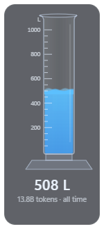

# ThirstyClaude

A small always-on-top desktop widget: a graduated cylinder that fills with the
estimated water behind your Claude Code token use.



*Screenshot uses demo data.*

## Install

Needs [Node.js](https://nodejs.org) 18 or later and Claude Code.

```bash
npm install -g github:BDigness/ThirstyClaude
thirstyclaude
```

Or from a clone:

```bash
git clone https://github.com/BDigness/ThirstyClaude.git
cd ThirstyClaude
npm install
npm run dev
```

Developed on Windows. macOS and Linux should work but haven't been tested.

## Use

- Drag the cylinder anywhere. It remembers its position.
- Right-click it, or the tray icon, for options:
  - period: today, last 7 days, last 30 days, all time
  - which water to count
  - size
  - always on top
  - start at login (Windows and macOS)
- Hover over the numbers for a breakdown: energy, requests and token types.
- Click the tray icon to show or hide the cylinder.

## Privacy

- **Local only.** ThirstyClaude reads Claude Code's session logs on your computer:
  `~/.claude/projects`, `~/.config/claude/projects`, or `$CLAUDE_CONFIG_DIR/projects`.
  It only uses the token counts, timestamps and model names. It never reads your
  prompts or code.
- **No network.** The app blocks every request that isn't a local file and turns
  off Chromium's background networking. There is no telemetry and there are no
  updates. The only download is at install time, when npm fetches Electron.
- **Your totals stay on your machine**, in the app's data folder:
  - Windows: `%APPDATA%\ThirstyClaude`
  - macOS: `~/Library/Application Support/ThirstyClaude`
  - Linux: `~/.config/ThirstyClaude`

  The app keeps a running total there, so the all-time figure doesn't drop when
  Claude Code deletes old logs.

## How the estimate works

Anthropic doesn't publish energy or water figures per request, so this is an
order-of-magnitude estimate built from public numbers.

1. **Tokens:** every API response in your logs is counted once. That includes
   subagents and only Claude models.
2. **Energy:** Wh per million tokens for Opus-class models. Other model families
   are scaled: Sonnet ×0.5, Haiku ×0.1, Fable ×2.

   | Token type | Wh per 1M |
   |---|---|
   | Output | 800 |
   | Cache writes | 200 |
   | Input | 160 |
   | Cache reads | 8 |

   A typical long-context Claude Code request works out to roughly 3–4 Wh.
   Cache reads are most of your tokens but cost little, because nothing is
   recomputed.
3. **Water:** about **3 L per kWh** including water evaporated at power plants,
   or about **0.5 L per kWh** for data-center cooling only. You can switch
   between the two in the menu.

To use your own assumptions, edit the constants in [`model.js`](model.js).

Background reading:

- [Google's 0.26 mL per Gemini prompt (cooling only), and its critics](https://www.pcgamer.com/software/ai/theyre-just-hiding-the-critical-information-google-says-its-gemini-ai-sips-a-mere-five-drops-of-water-per-text-prompt-but-experts-disagree-with-its-findings)
- [AI water usage, including power-plant water](https://greencalculus.com/data/ai-water-usage/)
- [What AI water numbers actually measure](https://inzonex.co.uk/ai/reports/ai-data-center-water-evidence-2026)

## Uninstall

1. Choose Quit from the tray menu.
2. Run `npm uninstall -g thirstyclaude`.
3. Delete the app data folder listed above.

## License

MIT
