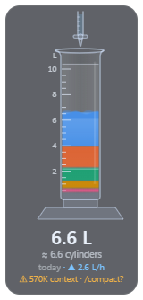
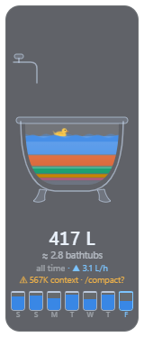
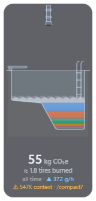
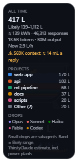

# ThirstyClaude

A small always-on-top desktop widget that fills with the estimated water behind
your Claude Code (and Codex) token use. Each response drips in live. It can
fill with the estimated CO₂ instead.

<p>
  
  
  
  
</p>

*Screenshots use demo data.*

## Install

Needs [Node.js](https://nodejs.org) 18 or later, plus Claude Code and/or Codex.

```bash
npm install -g github:BDigness/ThirstyClaude
thirstyclaude
```

Or from a clone:

```bash
git clone https://github.com/BDigness/ThirstyClaude.git
cd ThirstyClaude
npm install
npm run dev
```

Developed on Windows. macOS and Linux should work but haven't been tested.

## What you're looking at

- **The vessel grows with the amount.** Each vessel roughly matches its real
  capacity:

  | Vessel | Shown for |
  |---|---|
  | Test tube | under 100 mL |
  | Drinking glass | up to 1 L |
  | Graduated cylinder | up to 10 L |
  | Bucket | up to 50 L |
  | Rain barrel | up to 300 L |
  | Bathtub | up to 2,000 L |
  | Hot tub | up to 20,000 L |
  | Swimming pool | anything larger |

  You can also pin one vessel in the menu. The caption counts the amount in
  whichever vessel is showing, for example "≈ 2.1 rain barrels" or
  "≈ 0.03 swimming pools".

  | Vessel | Counted as |
  |---|---|
  | Test tube | 20 mL |
  | Glass | 250 mL |
  | Cylinder | 1 L |
  | Bucket | 10 L |
  | Rain barrel | 200 L |
  | Bathtub | 150 L |
  | Hot tub | 1,500 L |
  | Swimming pool | 50,000 L (backyard size) |
- **Layers are projects.** Your five biggest projects get a colour each, and the
  rest go into "Other". A project keeps its colour over time. Hover over a layer
  to see its project, litres and share.
- **Drops are responses.** Each response drips in within about 0.1 seconds of
  being written to the log. Drops are coloured by model, and smaller drops come
  from subagents.

  | Opus | Sonnet | Haiku | Fable | Codex |
  |---|---|---|---|---|
  | violet | red | green | magenta | amber |

- **Level up.** When the amount outgrows its vessel (on Automatic), the old one
  shrinks, tips over and pours into the next size up, with a small
  "Bucket → Rain barrel" banner.
- **Drag it around and the water sloshes.** It leans against the motion, surges
  when you stop, and settles. Glassware rocks quickly; the bathtub and pool sway
  slowly. Drag hard enough when it's nearly full and a few drops go over the rim
  and splash below.
- **Rubber duck.** The bathtub, hot tub and pool have one. It bobs, drifts, and
  slides downhill when the water tilts.
- **Freezes when idle.** After two hours with no responses the water starts to
  ice over, and after three it's solid. The next response cracks the ice, a few
  shards pop off, and it melts.
- **Boils when busy.** At more than about five responses a minute (several
  subagents at once, say), bubbles rise and steam curls off the surface. It
  calms down when things slow.
- **Jar shelf** (menu): a row of jars under the widget, one per day for the last
  7 or 30 days, filled to that day's amount. Hover over a jar for its date and
  total. Today's jar is outlined.
- **Every vessel has a source.** Drops come from a dropper, a kitchen tap, a
  burette, a garden spigot, a downspout, the bath tap, a hose or a rain cloud.
- **CO₂ mode.** Choose *Fill with → CO₂* and the vessel fills with grey smoke
  from an exhaust pipe. The amount is shown in grams or kilograms, and the
  caption compares it to something you can picture. On *Automatic* it picks the
  comparison that gives a readable number; *Count CO₂ in* can pin one.

  | Amount | Counted in |
  |---|---|
  | under 50 g | phone charges |
  | under 1 kg | cigarettes |
  | under 30 kg | minutes or hours of car idling |
  | under 600 kg | tires burned |
  | more | trees absorbing it for a year |

  Km driven is available too.
- **⚠ Context hint.** Every reply re-reads the whole conversation, so a long
  session costs more per reply. When the active session's context passes 400K
  tokens, an amber line such as "⚠ 452K context · /compact?" appears. The
  legend shows what each reply costs at that size. The threshold can be changed
  or turned off in the menu.
- **Drip sounds** (off by default): a soft plink for each drop, lower for bigger
  vessels, and a puff in CO₂ mode. The sounds are generated in the app, so there
  are no audio files.
- **The faint band is the likely range.** Every estimate here is uncertain, so the
  band shows how low or high it could plausibly be.
- **▲ L/h is the flow rate:** your usage over the last 10 minutes, scaled to an
  hour.
- **Hover over the numbers** for the full breakdown: range, energy, responses,
  tokens, projects, and the drop colours.

## Menu

Right-click the widget, or the tray icon. Click the tray icon to show or hide the
widget. Drag the widget anywhere by its glass, edges or empty space (the water
itself is for hovering). It remembers its position.

| Option | What it does |
|---|---|
| Empty / Drain | Named for what's showing: "Empty test tube", "Empty cylinder", "Drain bathtub" or "Drain pool". Pours the water out, so you can measure one task ("since 3:42 PM"). Your real totals keep counting. `thirstyclaude --empty` does the same from a terminal. |
| Period | This session, today, last 7 days, last 30 days, all time, or since emptied. *This session* follows the newest session that has replied in the last 10 minutes, so it starts from zero whenever you open a new one. If no session is active, it shows the last one that replied. |
| Fill with | Water, or CO₂ (carbon emissions). |
| Count CO₂ in | Automatic, phone charges, cigarettes, car idling, km driven, tires burned, or trees for a year. |
| Estimate | ThirstyClaude or EcoLogits (see below). |
| Water counted | Including power plants, or data-center cooling only. |
| Include Codex | Count Codex sessions as well as Claude Code. |
| Context hint | Over 200K, 400K (default) or 600K tokens, or off. |
| Drip sounds | Off by default. |
| Jar shelf | Off, last 7 days, or last 30 days. |
| Vessel | Automatic (grows with the amount), or always one vessel: test tube, glass, cylinder, bucket, rain barrel, bathtub, hot tub or pool. |
| Size | Tiny, Small, Medium, Large, Extra large or Huge (60%–200%). |
| Always on top | Keeps the widget above other windows. |
| Start with Windows / Open at login | Starts the widget when you log in (Windows and macOS). |

## Status line for Claude Code

`thirstyclaude --statusline` prints one line for Claude Code's status bar:

```
💧 85 mL this session · 1.4 L today · ⚠ 452K context
```

To use it, add this to `~/.claude/settings.json`:

```json
{
  "statusLine": { "type": "command", "command": "thirstyclaude --statusline" }
}
```

How it works:

- **This session** is read from the session's own transcript, so it works even
  when the widget isn't running. Only new lines are read each time.
- **Today** appears while the widget is running.
- **The context warning** uses the same threshold as the widget.
- **Settings:** it follows the widget's Fill with, Estimate and Water counted
  choices.

## Privacy

- **Local only.** ThirstyClaude reads session logs on your computer: Claude Code's
  `~/.claude/projects` (or `$CLAUDE_CONFIG_DIR`) and Codex's `~/.codex/sessions`
  (or `$CODEX_HOME`). From each response it uses only the token counts,
  timestamp, model name, and the name of the project folder. It never reads your
  prompts or code.
- **No network.** The app blocks every request that isn't a local file and turns
  off Chromium's background networking. There is no telemetry and there are no
  updates. The only downloads happen at install time, when npm fetches Electron
  and `fzstd`, a small decompressor for Codex's compressed logs.
- **Your totals stay on your machine**, in the app's data folder:
  - Windows: `%APPDATA%\ThirstyClaude`
  - macOS: `~/Library/Application Support/ThirstyClaude`
  - Linux: `~/.config/ThirstyClaude`

  The app keeps a running total there, so the all-time figure doesn't drop when
  old logs are deleted. It also writes a small `status.json` (today's total and
  recent sessions) for the status line, and the status line keeps its read
  positions in `statusline.json`.

## How the estimate works

Neither Anthropic nor OpenAI publishes energy or water figures per request. So
ThirstyClaude offers two independent estimates. They usually land within a
factor of two of each other.

### ThirstyClaude estimate (default)

Every token type counts, weighted by how much computing it takes. The table shows
Wh per million tokens for Opus-class models.

| Token type | Wh per 1M |
|---|---|
| Output | 800 |
| Cache writes | 200 |
| Input | 160 |
| Cache reads | 8 |

Other model families are scaled from these values:

| Family | Scale |
|---|---|
| Sonnet | ×0.5 |
| Haiku | ×0.1 |
| Fable | ×2 |
| GPT large / standard / small | ×1.4 / ×0.7 / ×0.3 |

A typical long-context Claude Code request works out to roughly 3–4 Wh. The likely
range takes energy from half to double these values, combined with the
water-factor range.

### EcoLogits estimate

This option follows [EcoLogits](https://ecologits.ai/latest/methodology/llm_inference/),
the open methodology from GenAI Impact:

- **Tokens:** only output tokens count.
- **Energy:** scales with each model's estimated active parameters and the number
  of GPUs needed to hold it, plus server overhead and data-center PUE.
- **Water:** IT energy × (on-site WUE + PUE × the off-site water intensity of US
  electricity).
- **Inputs and range:** model sizes, PUE and WUE are EcoLogits' own published
  estimates, and the range comes from their minimum and maximum values.

### Water counted

- **Including power plants** (default) adds the water evaporated to generate the
  electricity. That's about 3 L per kWh in the ThirstyClaude estimate.
- **Data-center cooling only** counts just the cooling water. That's about 0.5 L
  per kWh.

### CO₂

CO₂ = estimated energy × 0.394 kg CO₂ per kWh. That figure is the US grid
average including line losses (EPA eGRID2022), as used by EPA's
[Greenhouse Gas Equivalencies Calculator](https://www.epa.gov/energy/greenhouse-gas-equivalencies-calculator-calculations-and-references).

- **Range:** the ThirstyClaude estimate also spans cleaner and dirtier grids
  (0.25–0.45 kg per kWh).
- **Not included:** emissions from manufacturing the hardware.
- **Comparisons** (CO₂ each):

  | Comparison | CO₂ | Source |
  |---|---|---|
  | Phone charge | 7.5 g | 0.019 kWh per charge (EPA) on the average grid |
  | Cigarette | 14 g | Whole life cycle ([Zafeiridou et al., 2018](https://spiral.imperial.ac.uk/handle/10044/1/61157)) |
  | Car idling | 1.4 kg per hour | A compact car burns 0.16 gal/h at idle ([Argonne](https://afdc.energy.gov/files/pdfs/argonne_idling_handout.pdf)); gasoline gives 8.887 kg CO₂ per gallon (EPA) |
  | Km driven | 244 g | Average gasoline car, 393 g per mile (EPA) |
  | Tire burned | 30 kg | A 25 lb passenger tire; tire fuel is 28 mmBtu per short ton at 85.97 kg CO₂ per mmBtu ([EPA, 40 CFR 98](https://codes.findlaw.com/cfr/title-40-protection-of-environment/cfr-pt-40-98-subpt-c-tbl-c-1/)) |
  | Tree for a year | 60 kg | One urban tree (EPA) |

To use your own assumptions, edit the constants in [`model.js`](model.js).

Background reading:

- [EcoLogits: LLM inference methodology](https://ecologits.ai/latest/methodology/llm_inference/)
- [Google's 0.26 mL per Gemini prompt (cooling only), and its critics](https://www.pcgamer.com/software/ai/theyre-just-hiding-the-critical-information-google-says-its-gemini-ai-sips-a-mere-five-drops-of-water-per-text-prompt-but-experts-disagree-with-its-findings)
- [AI water usage, including power-plant water](https://greencalculus.com/data/ai-water-usage/)
- [What AI water numbers actually measure](https://inzonex.co.uk/ai/reports/ai-data-center-water-evidence-2026)

## Command-line options

| Option | What it does |
|---|---|
| `--empty` | Empties the vessel, even while the widget is already running. |
| `--demo` | Shows made-up data, for trying it out or taking screenshots. |
| `--period=today` | Starts on a period: `session`, `today`, `week`, `month` or `all`. |
| `--vessel=tub` | Starts with a vessel: `auto`, `tube`, `glass`, `cylinder`, `bucket`, `barrel`, `tub`, `hottub` or `pool`. |
| `--size=large` | Starts at a size: `tiny`, `small`, `medium`, `large`, `xl` or `huge`. |
| `--show=co2` | Starts filled with `water` or `co2`. |
| `--sounds` | Turns drip sounds on. |
| `--co2unit=tire` | Counts CO₂ in: `auto`, `phone`, `cigarette`, `idle`, `km`, `tire` or `tree`. |
| `--shelf=7` | Shows the jar shelf: `0`, `7` or `30` days. |
| `--statusline` | Prints the status line (see above) instead of starting the widget. |

## Uninstall

1. Choose Quit from the tray menu.
2. Run `npm uninstall -g thirstyclaude`.
3. If you added the status line, remove `statusLine` from `~/.claude/settings.json`.
4. Delete the app data folder listed above.

## License

MIT
